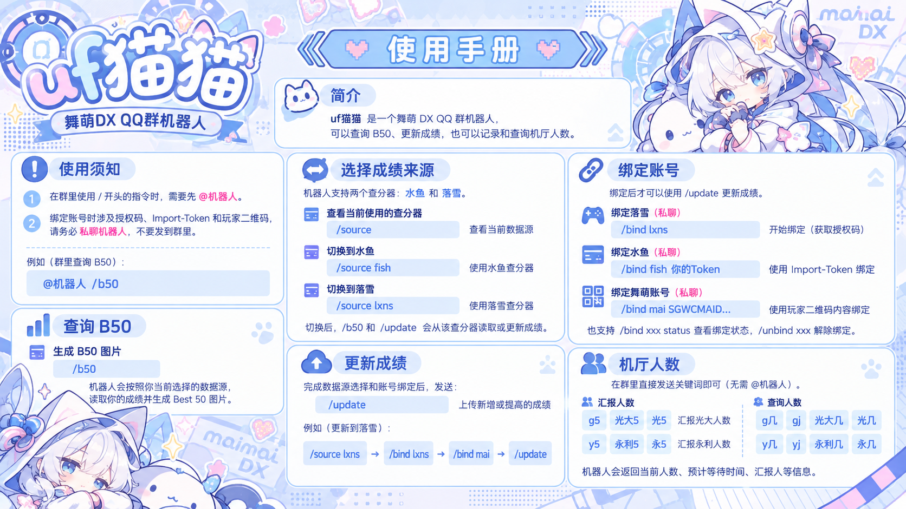

# KokaBot

KokaBot 是一个基于 Spring Boot 和 OneBot 11 的舞萌 DX QQ 群机器人。

它可以查询并绘制 B50、在水鱼和落雪之间切换数据源、从机台侧读取新成绩并同步到查分器，也能记录群友汇报的机厅人数。



## 主要功能

- 生成舞萌 DX Best 50 图片；
- 支持水鱼和落雪两个成绩数据源；
- 支持落雪 OAuth 授权；
- 支持水鱼 Import-Token 加密绑定；
- 支持舞萌玩家二维码 `SGWCMAID...` 绑定；
- 只同步新增或提高的机台成绩，跳过重复和更差记录；
- 群内汇报、查询光大和永利的当前人数；
- 根据一台机、每轮两人估算等待轮数和时间；
- 支持 Windows 本地运行和 Linux Docker 部署。

当前快捷更新不包含 FC、FC+、AP、AP+ 和同步标志。完整更新、签到积分和附近机厅功能尚未正式提供。

## 常用指令

群聊中的 `/` 指令需要先 `@机器人`，私聊时直接发送即可。

| 指令 | 用途 |
| --- | --- |
| `/help` | 发送图片版使用手册 |
| `/b50` | 生成当前数据源的 B50 图片 |
| `/source` | 查看当前数据源 |
| `/source fish` | 切换到水鱼 |
| `/source lxns` | 切换到落雪 |
| `/update` | 将机台的新成绩同步到当前数据源 |
| `/bind lxns` | 私聊绑定或重新授权落雪 |
| `/bind fish` | 私聊查看水鱼绑定方法 |
| `/bind mai` | 私聊查看舞萌二维码绑定方法 |
| `/bind xxx status` | 查看对应账号的绑定状态 |
| `/unbind xxx` | 删除对应的绑定信息 |

机厅人数功能在群聊中不需要 @机器人：

| 消息示例 | 用途 |
| --- | --- |
| `g5`、`光大5`、`光5` | 汇报光大当前有 5 人 |
| `g几`、`gj`、`光大几`、`光几` | 查询本群最近一次光大汇报 |
| `y5`、`永利5`、`永5` | 汇报永利当前有 5 人 |
| `y几`、`yj`、`永利几`、`永几` | 查询本群最近一次永利汇报 |

更完整的用户说明见 [KokaBot 使用手册](docs/KOKABOT_USER_GUIDE.md)。

## 工作方式

```text
QQ群 / 私聊
    │
    ▼
SnowLuma（OneBot 11）
    │ WebSocket
    ▼
KokaBot（Spring Boot）
    ├── 水鱼 / 落雪 API
    ├── maimai.py 机台数据适配器
    ├── B50 SVG 图片渲染
    └── MySQL 用户与绑定数据
```

KokaBot 会根据用户通过 `/source` 选择的平台执行 B50 查询和成绩同步。快捷同步只上传新增或提高的记录，完全相同或更差的数据不会重复写入。

## 技术栈

- Java 17
- Spring Boot 3.5
- MyBatis
- MySQL 8
- Apache Batik
- OneBot 11 / SnowLuma
- maimai.py REST 适配器
- Maven
- Docker Compose

## 本地运行

### 环境要求

- JDK 17；
- Maven 3.6 或更高版本；
- MySQL 8；
- SnowLuma；
- Windows amd64 版 maimai.py 适配器。

### 1. 建立数据库

创建 `maimai_bot` 数据库，然后按文件名顺序执行 `database` 目录中的 SQL：

```text
V001__create_bot_user.sql
V002__create_lxns_oauth_binding.sql
V003__create_maimai_account_binding.sql
V004__create_diving_fish_binding.sql
V005__create_arcade_occupancy_report.sql
```

### 2. 安装并启动 maimai.py

在 PowerShell 中执行：

```powershell
.\scripts\install-maimai-adapter.ps1
.\scripts\start-maimai-adapter.ps1
```

适配器默认监听 `127.0.0.1:8082`。详细说明见 [舞萌成绩同步说明](docs/MAIMAI_SYNC.md)。

### 3. 配置环境变量

至少需要配置：

```text
DB_URL
DB_USERNAME
DB_PASSWORD
ONEBOT_WEBSOCKET_URL
ONEBOT_ACCESS_TOKEN
TOKEN_ENCRYPTION_KEY
LXNS_API_KEY
LXNS_OAUTH_CLIENT_ID
LXNS_OAUTH_CLIENT_SECRET
```

`TOKEN_ENCRYPTION_KEY` 必须是 32 字节随机数据的 Base64 字符串。PowerShell 生成方式：

```powershell
$key = New-Object byte[] 32
$rng = [System.Security.Cryptography.RandomNumberGenerator]::Create()
$rng.GetBytes($key)
$rng.Dispose()
[Convert]::ToBase64String($key)
```

密钥配置后不要随意更换，否则数据库中已有的加密授权将无法解密。

### 4. 启动 KokaBot

```powershell
mvn spring-boot:run
```

或先打包：

```powershell
mvn package
java -jar target/maimai-bot-0.0.1-SNAPSHOT.jar
```

## Docker 云服务器部署

仓库已提供：

- `Dockerfile`；
- `compose.yaml`；
- MySQL 自动建表容器；
- maimai.py Linux 适配器镜像；
- SnowLuma 容器配置。

准备好 `.env` 后可以使用：

```bash
cp .env.example .env
docker compose up -d --build
```

首次部署还需要进入 SnowLuma 的 noVNC 页面扫码登录 QQ，并确保 OneBot WebSocket Token 与 `.env` 一致。

服务器部署前请完整阅读 [Docker 云服务器部署说明](docs/DOCKER_DEPLOYMENT.md)。当前 maimai.py Linux 成品要求服务器为 x86_64 架构。

## 测试

```bash
mvn test
```

只运行不依赖完整 Spring 环境的业务测试：

```bash
mvn "-Dtest=*Test,!MaimaiBotApplicationTests" test
```

## 数据与安全

- `.env`、`.runtime/`、本地数据和构建产物不会提交到 Git；
- 落雪 Token、水鱼 Import-Token 和舞萌玩家标识使用 AES-256-GCM 加密后写入数据库；
- 原始舞萌二维码不会写入数据库；
- maimai.py、MySQL 和 OneBot 端口不应直接暴露到公网；
- 授权码、Import-Token 和 `SGWCMAID...` 只能私聊机器人；
- 迁移数据库时必须同时保留原来的 `TOKEN_ENCRYPTION_KEY`。

## 项目结构

```text
database/                 MySQL 建表脚本
docker/                   Docker 辅助文件
docs/                     使用和部署文档
scripts/                  Windows 适配器脚本
src/main/java/            Java 业务代码
src/main/resources/       配置、MyBatis XML 与图片模板
src/test/java/            单元测试
compose.yaml              云服务器整套服务编排
Dockerfile                KokaBot 镜像
```

## 相关项目

- [maimai.py](https://github.com/TrueRou/maimai.py)
- [SnowLuma](https://github.com/SnowLuma/SnowLuma)
- [水鱼查分器](https://maimai.diving-fish.com/)
- [落雪查分器](https://maimai.lxns.net/)

本项目是玩家自用工具，与 SEGA、华立科技、水鱼或落雪官方无隶属关系。舞萌相关名称、图片及游戏素材的权利归各自权利人所有。
